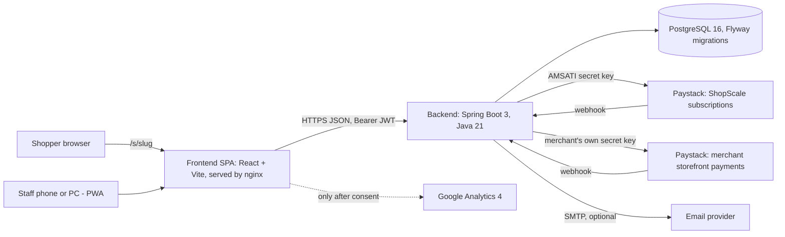
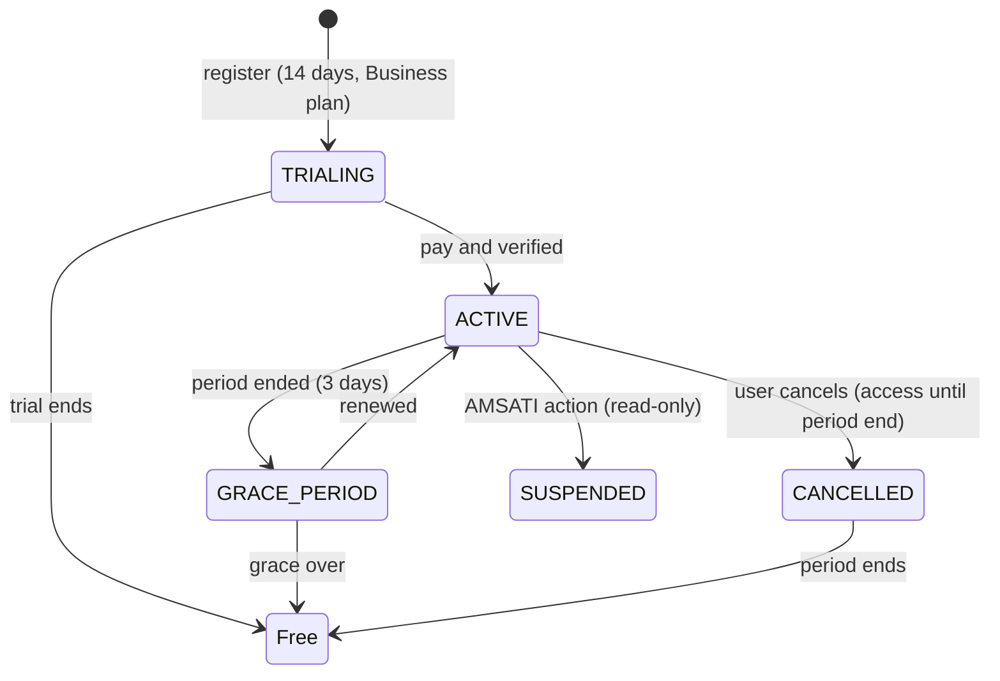

# ShopScale V1 - Owner's Guide

Written 2026-11-10 from the actual source code of `ShopScale-Backend` and `ShopScale-Frontend`. It is the primary operating reference.

**How to read the status words used throughout**

| Status | Meaning |
|---|---|
| **Implemented** | Code exists end to end (screen, API, database). |
| **Implemented, not verified** | As above, but it has never been compiled, run or tested against real services in the authoring environment (see 1.4). This applies to almost everything. |
| **Partial** | Some of it exists; the gaps are listed. |
| **Deferred** | Intentionally postponed to V1.1. Code may exist but there is no usable screen and it is not advertised. |
| **Not implemented** | Does not exist. |
| **Needs verification** | I could not confirm this from the code; check it before relying on it. |

## Table of contents
1. [Product overview](#1-product-overview)
2. [Technology stack and architecture](#2-technology-stack-and-architecture)
3. [User access and business management](#3-user-access-and-business-management)
4. [Application feature guide](#4-application-feature-guide)
5. [Pricing and subscription management](#5-pricing-and-subscription-management)
6. [Paystack and payment configuration](#6-paystack-and-payment-configuration)
7. [Online storefront management](#7-online-storefront-management)
8. [GA4 and business analytics](#8-ga4-and-business-analytics)
9. [Deployment and environment configuration](#9-deployment-and-environment-configuration)
10. [Database and data management](#10-database-and-data-management)
11. [Security and operational safety](#11-security-and-operational-safety)
12. [Troubleshooting](#12-troubleshooting)
13. [Known limitations and V1.1 roadmap](#13-known-limitations-and-v11-roadmap)
14. [Owner's operational checklist](#14-owners-operational-checklist)
15. [Commands and quick reference](#15-commands-and-quick-reference)

---

## 1. Product overview

### 1.1 What it does
ShopScale is a multi-tenant web application (an AMSATI product) that lets a small business in Nigeria record sales, manage stock, customers, suppliers and expenses, work from several locations, give staff limited access, and sell online through its own storefront. It is mobile-first and installable as a PWA.

### 1.2 Problems it solves
Paper or memory-based sales records; not knowing stock levels or what customers owe; staff seeing money they should not; selling only face to face; unreliable internet at the till (sales can be saved on the device and sent later).

### 1.3 Who it is for, and which industries
- **Fully supported in V1: shops and retail businesses** (fashion, cosmetics, electronics, groceries, household, general goods) and wholesale-style selling (price tiers, bulk prices).
- The onboarding screen shows "Restaurant or food business" and "Small chops or catering" as **not ready**. Backend enum values also exist for WHOLESALE, PRODUCTION and LIVESTOCK. Livestock is stored as the owner's choice only; its workflow is the same as retail. See section 13.

### 1.4 Honest verification status
In the environment where this was built there was no network, so:
- Java and JSX **syntax** was checked, and imports were checked to resolve.
- The 15 database migrations **were applied to an empty PostgreSQL 16** with psql, and entity fields were cross-checked against the resulting columns.
- A GA4 logic test file (12 tests) was executed with Node against a simulated browser.
- **Not run:** Maven compile and unit tests, `npm ci`, `npm run build`, Vitest, real Paystack calls, real devices (PWA, offline), real GA4. Treat the first `mvn -B verify` and `npm run build` as part of acceptance.

### 1.5 V1 contents vs deferred
| Area | Status |
|---|---|
| POS, sales, refunds, receipts, quotes and sales orders | Implemented, not verified |
| Products, variants, stock, adjustments, stock history, low-stock alerts | Implemented, not verified |
| Customers, credit, repayments, wholesale pricing | Implemented, not verified |
| Suppliers, purchase orders, receiving stock, supplier payments | Implemented, not verified |
| Branches, branch stock, stock transfers | Implemented, not verified |
| Team invitations, roles, custom permissions | Implemented, not verified |
| Expenses (with approval limit), cash/bank accounts, cashier shifts, money overview | Implemented, not verified |
| Dashboard, insights, sales report | Implemented, not verified |
| Notifications, activity history | Implemented, not verified |
| CSV export (products, customers, sales, expenses) | Implemented, not verified |
| Plans: Free/Essential/Growth/Business, limits, fallback to Free | Implemented, not verified |
| Subscription payments with Paystack (AMSATI) | Implemented, not verified |
| Online store + merchant Paystack + order management | Implemented, not verified |
| PWA install, offline page, offline POS queue | Implemented, not verified |
| GA4 analytics with consent | Implemented, logic tested only |
| Restaurant (menus, tables, kitchen), recipes, wastage, production, catering | **Deferred** (backend code and migration V12 exist, no screens) |
| Livestock features | **Not implemented** (type is stored only) |
| CSV import | **Not implemented** |
| Automatic recurring card billing | **Not implemented** |

### 1.6 Management app vs public storefront
- The **management application** needs a login. Staff use it at `/dashboard`, `/sell`, `/products`, `/more/...`.
- The **public storefront** is for shoppers, no login, at `/s/<business-slug>`. It shows only products and prices the merchant exposes, and shoppers can only place and track orders. Merchants run it from More > Online store and More > Online orders.

### 1.7 Architecture


---

## 2. Technology stack and architecture

| Layer | Actual technology |
|---|---|
| Backend | Spring Boot 3.3, Java 21, Maven, Spring Security (stateless JWT), Spring Data JPA/Hibernate (`ddl-auto: validate`), Lombok, Bean Validation, springdoc OpenAPI (Swagger UI at `/swagger-ui.html`), Actuator (only `/actuator/health` exposed), Spring Mail |
| Frontend | React 18, JavaScript (no TypeScript), Vite 5, React Router, lucide-react icons, Inter font, Vitest + Testing Library |
| Database | PostgreSQL 16 (`docker-compose.yml` uses `postgres:16`) |
| Migrations | Flyway, files `src/main/resources/db/migration/V1` to `V15` |
| Authentication | Email + password; BCrypt (cost 12); JWT access token (15 minutes) + refresh token (30 days, stored hashed in `refresh_tokens`, revocable) |
| Payments | Paystack, one shared client (`PaystackClient`) used with two different secret keys (section 6) |
| Hosting | Not fixed by the code. Provided: backend `Dockerfile` (Maven build, JRE 21, non-root), frontend `Dockerfile` (Node 22 build, nginx 1.27) and `nginx.conf` (SPA fallback, long cache for `/assets/`, no-cache for `sw.js` and the manifest). Neither Dockerfile has been built in the authoring environment. |
| PWA | Hand-written: `public/manifest.webmanifest`, `public/sw.js` (caches static files only; `/api/` is never cached), `public/offline.html`, install banner (Android prompt, iPhone Share-menu steps), update banner that waits for the user |
| Offline POS | IndexedDB queue (`lib/offlineQueue.js`). See 4.2 |
| Files/images | Product images are stored **in the database** (`product_images`, bytea), max 600 KB, JPEG/PNG/WebP detected from file bytes, served from `/api/public/images/{id}`. There is no object storage or CDN. |
| External services | Paystack (two uses), SMTP email (optional), Google Analytics 4 (optional, consent-gated) |

**Data flow.** The browser calls `VITE_API_URL + /api/...` with `Authorization: Bearer <access token>`. The API reads the business id and user id from the token, never from the request, and every query is filtered by that business id. When the access token expires the client uses the refresh token once and retries. Tokens are kept in the browser's `localStorage` (so sessions survive reloads on phones; see the XSS note in section 11).

---

## 3. User access and business management

### 3.1 Registration, email verification, login, recovery
- **Register** at `/register` (name, email, password, optional phone). A confirmation email is sent. On success the user is signed in and sent to onboarding.
- **Email verification**: `/verify-email?token=...`. Status: Implemented. It is **not enforced**: unverified users can still use the app; they see a banner. Email needs SMTP (below).
- **Login** at `/login`. **Forgot/reset password**: `/forgot-password`, `/reset-password?token=...`. Tokens are random, single-use, stored only as SHA-256 hashes, and expire. The forgot endpoint always answers success so it cannot be used to discover accounts.
- **Email delivery** requires the standard Spring mail variables plus `MAIL_FROM` (section 9). Without them, staff invitations still work (the inviter sees a link to send by WhatsApp), but **password-reset and verification emails cannot be delivered** (needs verification of exact fallback behaviour).
- Rate limit: 30 requests per minute per client address on login, register, reset, verification and public order endpoints (in memory, per server instance).

### 3.2 Onboarding and business profile
After sign-up the owner picks a business type, a category label (for retail), name, phone, and a store address slug (used in `/s/<slug>`). Currency is set to NGN and time zone to Africa/Lagos. Business settings are under More > Settings. A new business starts a **14-day trial on the Business plan** (`app.subscription.trial-plan`, `trial-days`); after it ends the business falls back to the Free plan (section 5).

### 3.3 Business type
Stored on the business. It decides which "workflows" the menu shows. Retail and wholesale-style businesses get the full V1 toolset; food, catering and production types currently get the same retail tools because their own screens are deferred.

### 3.4 Invitations and employees
More > Team > Add: name, email/phone and a role. The invitation link works once and expires after 7 days (`app.invitation-ttl-days`). The invitee opens `/accept-invite`, sets a password and joins. Owners/administrators can deactivate or reactivate staff; deactivated people lose access immediately and their records remain. **Seats**: users are limited by plan (Free 1, Essential 2, Growth 5, Business 10). Adding beyond the limit is refused.

### 3.5 Roles and permissions
You can only grant access you have yourself. Built-in roles (defined in code, cannot be edited by accident). Create a custom role under Team > Roles to change what a role can do.

| Role | Can | Cannot (by default) |
|---|---|---|
| **Owner** | Everything, including billing, store payments, team | - |
| **Administrator** | Everything except changing subscription/billing, the store's payment connection, integrations | Billing and Paystack keys |
| **Manager** | Sales, refunds, discounts, voiding, quotes, products and stock (incl. transfers, adjustments), customers and balances, suppliers and purchases, online store orders, locations, wholesale prices, shifts, activity history, CSV export, sales/inventory/customer reports | Profit/expenses, team management, billing |
| **Cashier** (Sales staff) | Record sales, print receipts, view products/stock, add customers, manage own shift, see own sales | Everything else |
| **Storekeeper** (Inventory staff) | Add/edit products, restock, adjust stock, transfers, suppliers view, record purchases, inventory report | Sales, money |
| **Accountant** | Sales and finance views, expenses (create and approve), customer balances and repayments, supplier payments, cash/bank accounts, shifts reconciliation, activity history, exports, financial reports | Product and stock editing |
| **Kitchen staff** | Kitchen order screens (part of the deferred restaurant module) | No money information |

The exact permission list is in `security/Permission.java` and `security/DefaultRoles.java`. The server checks permission on every API call; hidden buttons are only a convenience.

### 3.6 Branches and switching
More > Locations (Growth and above for more than one). Stock is held per branch. Each device keeps a "current branch"; sales and purchases are recorded against it. Staff see the locations the business has. (How per-user branch restriction works: needs verification; the code stores the selected branch on the device.) Stock moves between branches only through **Stock transfers**.

### 3.7 Tenant isolation
Every business-owned table carries `business_id`. The id comes from the signed JWT. Repositories and services always filter by it, and lookups by id also check the business. Public endpoints (storefront) identify a business by its slug and never accept a business id. There is no row-level security in PostgreSQL itself; isolation relies on application code (section 11).

---

## 4. Application feature guide

Menu: the bottom bar has **Home, Sell, Products, Customers, More**. Everything else is under More (also a sidebar on desktop). Items appear only if the person has the permission and the plan includes the feature.

### 4.1 Dashboard (`/dashboard`)
Sales, expenses and gross profit trend, top products, categories, payment-method totals, slow movers, and "what needs your attention" insights (rule-based, from `InsightRules`). Money figures need `DASHBOARD_FINANCIAL`. *Plan: all (Free = basic dashboard).*

### 4.2 POS and sales (`/sell`)
Search or scan products, build a cart, discount, choose a customer, pay in full, part (balance owed) or later. Prices are **always recalculated on the server** (customer-agreed price, then tier price, then bulk break, then standard price); the screen only previews. Each sale is idempotent by a request id so a retry cannot double-record. Receipts print from the browser. Refunds/returns: partial refunds restock the items. Sales history: More > Sales. *Limits:* a read-only subscription (suspended/expired) cannot record sales.
**Offline POS:** if the network fails, a sale that is paid in full and has no customer is saved on the device, shown as **"not confirmed yet"**, and sent automatically with its request id when online. More > "Sales saved offline" lists them with Retry/Discard. Sales with a customer, part payments or credit need a connection. Logging out warns if sales are unsent. Not verified on real devices.

### 4.3 Products and inventory (`/products`, More > Stock)
Products with sizes/colours/options (variants), SKU, barcode, price, cost, category, photo (editing an existing product), archive/restore, stock per branch, decimal quantities and unit conversions, adjustments with reason, stock history, low-stock list and alerts (notification). Only **active** products count toward plan limits.

### 4.4 Customers, credit, wholesale
Customers with phone/address, a balance owed, repayments (More or customer page). Customer type (retail/wholesale) and price tier. More > Wholesale prices: price tiers, per-product bulk breaks (minimum quantity) and agreed prices per customer. *Plan: Essential and above for wholesale pricing.*

### 4.5 Suppliers, purchasing, receiving (`/suppliers`, `/purchases/new`, More > Supplier orders)
Supplier records and balances, **receiving stock** (raises stock and updates cost), part payment to suppliers, **purchase orders** to suppliers. Supplier count is limited by plan. The code uses one `PURCHASING` feature for purchase orders; "basic" vs "advanced" purchasing is not separated.

### 4.6 Quotes and sales orders (More > Quotations, Customer orders)
Create a quote or customer order, convert to a sale. Permission `QUOTES_MANAGE`.

### 4.7 Expenses (`/expenses`)
Record expenses by category and method. If the business sets an approval limit, expenses at or above it by someone who cannot approve wait as PENDING and do not affect the books until approved (notification to approvers). *Free: 15 expenses.* (The backend supports the approval limit on the business, but **no Settings screen sets it yet**; it can only be set in the database.)

### 4.8 Cash and financial management
More > Money overview, Cash and bank (accounts, manual entries, transfers between accounts), Cashier shifts (open, close, reconcile). Debtors and payables lists. *Plan: cash accounts Essential+, reconciliation Growth+.*

### 4.9 Branches and stock transfers
More > Locations, More > Stock transfers: send stock from one branch to another with status tracking. *Growth+ (Essential has one location).*

### 4.10 Notifications and activity history
More > Notifications (low stock, expenses awaiting approval, new online orders, billing messages); a bell with a count shows in the top bar. More > Activity history lists who did what (audit log) with filters. *Activity history: Business plan feature flag.*

### 4.11 Reports
More > Sales reports (period totals grouped by employee, location, payment type or sales channel) and the dashboard (trend, top products, categories). Several "advanced/consolidated reporting" flags exist in the plan table but have no separate screens (Partial).

### 4.12 Data export (More > Export data)
CSV of products and stock, customers (with amounts owed), sales, expenses. Cells beginning with `=`, `+`, `-`, `@` are prefixed so spreadsheets cannot run them. Each export is audit-logged. *Essential and above; Free has no export.* **Import is not implemented.**

### 4.13 Online store, orders, public storefront
Section 7. *Growth and above.*

### 4.14 Subscription and billing
Section 5 and 6. Page: More > Plan.

### 4.15 PWA installation
- Android/desktop Chrome: an "Install ShopScale" banner or the Help page button uses the browser's install prompt.
- iPhone: Safari > Share > Add to Home Screen (the banner shows these steps).
- The app updates only when the user taps the update banner, and never mid-sale. An offline page appears when the app has not been opened before.

---

## 5. Pricing and subscription management

### 5.1 Approved configuration (V15, verified in the database)
| Plan | Monthly | Annual | Users | Locations | Products | Customers | Expenses | Suppliers |
|---|---:|---:|---:|---:|---:|---:|---:|---:|
| Free | ₦0 | ₦0 | 1 | 1 | 15 | 15 | 15 | 5 |
| Essential | ₦4,999 | ₦49,990 | 2 | 1 | 100 | 100 | 100 | 20 |
| **Growth (recommended)** | ₦11,999 | ₦119,990 | 5 | 2 | 500 | Unlimited | Unlimited | 50 |
| Business | ₦24,999 | ₦249,990 | 10 | 5 | Unlimited | Unlimited | Unlimited | Unlimited |

"Unlimited" is stored as NULL. Annual price = 10 x monthly ("2 months free"). The old STARTER plan is hidden, not deleted. Prices, limits and features live in the `plans` and `plan_features` tables, **not in code**; the pricing pages read them from the API.

Feature split: Free = basic POS, sales, stock and stock history, expenses, customers and credit, basic dashboard. Essential adds CSV export, purchase orders, supplier balances, cash accounts, improved dashboard, wholesale pricing. Growth adds the online store and orders, branch transfers, staff permissions, advanced reports/inventory, location reporting, cash reconciliation. Business adds custom domain, advanced finance and staff permissions, activity history, consolidated reporting, priority support. Several flags (staff permissions, advanced reports, advanced finance, priority support, consolidated reporting) are assigned but have no dedicated enforcement or screen yet.

### 5.2 Lifecycle

- **Limit reached**: the action is refused with a clear "upgrade" message (HTTP 402) - adding a user, location, active product, customer, expense or supplier. Nothing existing is changed or deleted. Limits are enforced on the server; the screens cannot override them.
- **Expiry**: an expired trial or paid plan **falls back to the Free plan** (writable, with Free limits and features). Existing data stays visible. SUSPENDED is the only fully read-only state.
- **Switching to Free** (More > Plan): refused while you have more users or locations than Free allows. No data is deleted.
- **Upgrades and downgrades**: choose a plan and monthly/annual, see a quote, pay. If you have an active paid plan and change plan, the unused time on your current plan is credited against the new price (prorated by time). A change is refused if unused credit leaves less than ₦100 to pay, or if your users/locations exceed the new plan's limits. Renewal of the same plan and billing period **stacks onto remaining time**. A change starts the new period immediately.
- **Annual billing**: pay once for 12 months.
- **No automatic charging.** Each period is prepaid with a new checkout; a daily job sends "plan ends soon" notifications 3 days before.

### 5.3 How payments are verified
1. Owner clicks Pay: the server creates a `subscription_payments` row (PENDING, unique reference `SSB-...`) and a Paystack transaction on the AMSATI account.
2. The browser goes to Paystack, then returns to `/more/plan?reference=...`.
3. The page calls `POST /api/subscriptions/verify`; **the server asks Paystack** itself. The webhook (`/api/webhooks/paystack/subscriptions`) does the same independently. Whichever comes first activates, once (row lock).
4. Activation requires: Paystack status success, amount in kobo equal to the amount we recorded, currency NGN, matching reference. Otherwise the row becomes MISMATCH and nothing activates.
A browser redirect alone never activates a plan.

### 5.4 Failed payment and troubleshooting
A declined/abandoned payment becomes FAILED with a notification; the plan is unchanged and the user can retry. Look at More > Plan > Payment history. For a customer who paid but is not active: find the row by reference in `subscription_payments`; if PENDING, ask them to open the plan page again (re-verifies) or check the webhook delivery log in the Paystack dashboard; if MISMATCH, investigate in Paystack and fix manually. See section 12.

---

## 6. Paystack and payment configuration

### 6.1 Two separate flows
| | ShopScale subscriptions | Merchant storefront |
|---|---|---|
| Whose Paystack account | **AMSATI** (yours) | **Each merchant's own** |
| Secret key | Server env `PAYSTACK_SECRET_KEY` | Entered by the merchant in More > Online store; stored encrypted (AES-GCM) with `APP_ENCRYPTION_KEY`; never shown again |
| Webhook URL | `https://<api>/api/webhooks/paystack/subscriptions` | `https://<api>/api/webhooks/paystack/store/<merchant-slug>` (shown to the merchant) |
| Signature check | HMAC-SHA512 of the raw body with your secret | Same, with that merchant's secret |
| Money goes to | AMSATI | The merchant |

### 6.2 Required variables
`PAYSTACK_SECRET_KEY`, `APP_ENCRYPTION_KEY` (32 random bytes, base64: `openssl rand -base64 32`), `PUBLIC_API_URL` (public https address of the API; used in webhook URLs and image links), `FRONTEND_URL`, optional `STOREFRONT_URL`. If `PAYSTACK_SECRET_KEY` is empty the Plan page says online payment is not switched on and checkout is refused. If `APP_ENCRYPTION_KEY` is empty merchants cannot save Paystack keys. **Losing `APP_ENCRYPTION_KEY` means every merchant must re-enter their keys.**

### 6.3 Verification, references, states
- Subscription references start `SSB-`; storefront references start `SSO-`. They are random and unique.
- Storefront orders: PENDING_PAYMENT until verified; paid orders become NEW and a sale is recorded; amount/currency mismatches and "paid after cancel" are flagged "needs attention" on the order, never silently lost.
- Pending: the shopper's order page re-verifies every 4 seconds up to 5 times; after that it can be reopened later from the same link.

### 6.4 Testing
Use Paystack **test** keys (`sk_test_...`) in `PAYSTACK_SECRET_KEY`, run the flow with Paystack's test cards, and make the webhook reachable (for local work, a tunnel such as ngrok pointing to your API; needs verification for your setup). Then check `subscription_payments` and the Paystack dashboard's webhook log. **This has not been done against real Paystack yet.** Never go live with test keys or the reverse.

### 6.5 Never expose
`PAYSTACK_SECRET_KEY`, merchants' secret keys, `APP_ENCRYPTION_KEY`, `JWT_SECRET`, `DB_PASSWORD`, SMTP credentials, database dumps. Public keys (`pk_...`) and the GA4 Measurement ID are not secrets. No endpoint returns a stored secret key.

---

## 7. Online storefront management

### 7.1 Enable
More > Online store (permission `STORE_VIEW`, edit `STORE_EDIT`, publish `STORE_PUBLISH`). Requires the Growth plan or above. Fill name, description, phone/WhatsApp, pickup and/or delivery (delivery fee and note), and at least one way to pay: connect Paystack and/or allow pay on pickup/delivery. Switch "Open my store". The store URL is **`<frontend>/s/<business-slug>`**, for example `https://app.shopscale.fidmap.co/s/ada-fashion`. The slug is chosen at onboarding.

### 7.2 Which products appear
Active products of kind goods/finished, shown with their standard price. Sold out items are marked and cannot be added; stock is taken from the store's branch (the main branch by default). Prices and totals are recalculated on the server at checkout. Wholesale/customer-specific prices are not applied to shoppers.

### 7.3 Product photos
Edit a product (More > Products > product) > Add photo. The phone shrinks it to 900 px JPEG first; the server accepts JPEG/PNG/WebP up to 600 KB, checks the file's real type, and stores it in the database.

### 7.4 Checkout and orders
Shopper: add to cart (saved on their device) > name, phone, email (required for online payment), pickup or delivery > pay now (Paystack, merchant's account) or pay later > order page `/s/<slug>/order/<token>`. The token is a long random secret that identifies the order; anyone with the link can see that order's status.
Merchant: More > Online orders (permission `STORE_ORDERS_MANAGE`). New orders create a notification. Flow: NEW > Confirm > CONFIRMED > Mark ready > READY > **Complete**. Pay-later orders ask how the customer paid (cash/transfer/card) when completing, and the sale is recorded then. Paid-online orders record the sale when payment is verified. Cancelling is blocked after a sale exists (refund from Sales); cancelling a paid online order shows a reminder to refund in Paystack. Refunds to the shopper are done in the merchant's Paystack dashboard; ShopScale does not issue them.

### 7.5 Custom domains (Business plan) - Partial
A merchant can enter a domain, receives a TXT value (`_shopscale-verify.<domain>`), and the server checks DNS. **Verification only marks the domain as verified.** Serving the storefront at the domain's root needs you to point the domain at the frontend host and add TLS, and the frontend does not yet switch to the store when opened on a merchant's own domain (an API lookup exists, `GET /api/public/domain?host=`, but no screen uses it). Treat custom domains as incomplete.

### 7.6 Routes
Public: `GET /api/public/store/{slug}`, `/products`, `POST /api/public/store/{slug}/orders`, `GET /api/public/orders/{token}`, `POST /api/public/orders/{token}/verify`, `GET /api/public/images/{id}`, `POST /api/webhooks/paystack/store/{slug}`. Merchant: `/api/store/settings`, `/paystack`, `/domain`, `/orders`.

---

## 8. GA4 and business analytics

Full steps are in `ShopScale-Frontend/docs/GA4_SETUP.md`. Summary:
1. Create a GA4 property and a **Web** data stream; copy the **Measurement ID** (`G-XXXXXXXXXX`) from the stream page.
2. Set `VITE_GA_MEASUREMENT_ID` when **building** the frontend (it is compiled in): in `.env.local`, or `--build-arg VITE_GA_MEASUREMENT_ID=...` for Docker. Rebuild and redeploy. Not set = analytics fully off.
3. **Consent**: nothing loads or is sent until a visitor clicks "Allow analytics". Do Not Track/GPC count as "no". Visitors can change it in More > Help > Privacy. Storefront pages are never tracked.
4. **Events**: `page_view`, `sign_up`, `login`, `onboarding_completed`, `view_pricing`, `select_plan`, `begin_checkout`, `purchase` (only after backend-verified payment, once per transaction id), `plan_upgrade`, `product_create`, `sale_complete`, `stock_receive`, `branch_create`, `employee_invite`, `data_export`. No emails, phones, names, sale amounts or record contents are sent (allowlist + filter).
5. **Verify**: DebugView (with the Google Analytics Debugger extension) and Reports > Realtime. **Not yet verified against Google** because no Measurement ID existed.
6. **Use it**: registrations = `sign_up`; activations = `onboarding_completed`; conversions = `purchase` (mark it, `sign_up` and `onboarding_completed` as key events); pricing interest = `view_pricing` > `select_plan` > `begin_checkout` funnel; adoption = `product_create`, `sale_complete`.
7. **Limits**: GA4 sees only people who consent, so it undercounts. A purchase is reported when the payer returns to the app; if they pay and close the browser, the subscription still activates through the webhook but GA4 does not see it. For money figures use Paystack and the database, not GA4.
8. **Disable**: remove the variable, rebuild, redeploy.

**GA4 vs ShopScale reports.** GA4 measures how people use *ShopScale itself* (your acquisition and conversion). ShopScale's dashboard and reports show each *merchant's own* business data. They are separate and neither feeds the other. Merchant storefront analytics do not exist in V1.

---

## 9. Deployment and environment configuration

### 9.1 Backend variables (`application.yml`)
| Variable | Required | Purpose |
|---|---|---|
| `DB_URL`, `DB_USERNAME`, `DB_PASSWORD` | password required | PostgreSQL |
| `JWT_SECRET` | **yes** (app will not start) | >= 32 chars; `openssl rand -base64 48`. Changing it signs everyone out |
| `CORS_ALLOWED_ORIGINS` | yes in production | Comma-separated frontend origins, e.g. `https://app.shopscale.fidmap.co`. `/api/public/**` additionally allows any origin (no credentials) |
| `FRONTEND_URL` | yes | Used in email links and Paystack return pages |
| `PUBLIC_API_URL` | yes for store/billing | Public API URL |
| `STOREFRONT_URL` | no | Default `FRONTEND_URL/s` |
| `PAYSTACK_SECRET_KEY` | for paid plans | AMSATI key |
| `APP_ENCRYPTION_KEY` | for merchant Paystack | base64 32 bytes |
| `MAIL_FROM` + `SPRING_MAIL_HOST/PORT/USERNAME/PASSWORD` (+ `..._PROPERTIES_MAIL_SMTP_AUTH`, `..._STARTTLS_ENABLE`) | no | Email |
| `PORT` | no | Default 8080 |
Business rules in `application.yml` under `app.*`: trial plan/days, grace days (3), invitation days (7), enabled business types.

### 9.2 Frontend variables (build time)
`VITE_API_URL` (API base, no `/api`), `VITE_GA_MEASUREMENT_ID`, `VITE_SITE_URL` (public site address for SEO), `VITE_SUPPORT_EMAIL`, `VITE_WHATSAPP_NUMBER`. Changing any requires a rebuild.

### 9.3 Steps
1. **PostgreSQL 16**: create database and user (`CREATE DATABASE shopscale; CREATE USER shopscale WITH PASSWORD '...'; GRANT ALL ON DATABASE shopscale TO shopscale;` and grant schema rights as your host requires).
2. **Backend**: build `mvn -B -DskipTests package` (or `docker build -t shopscale-backend .`), set the variables, run. **Flyway applies migrations automatically at start**; Hibernate then validates the schema and the app refuses to start on a mismatch.
3. **Frontend**: `npm ci && npm run build`, serve `dist/` with nginx using the provided `nginx.conf` (SPA fallback is required so `/s/...` and `/more/...` reload correctly), or the Dockerfile with build args.
4. **Domains**: your plan was marketing `shopscale.fidmap.co`, app `app.shopscale.fidmap.co`, API on its own host (e.g. `api.shopscale.fidmap.co`). The one frontend build contains both the marketing pages and the app; whether you serve it on one or both hosts is your choice (the build has no host-specific switch - needs verification of your preferred layout).
5. **HTTPS is required**: service workers, installable PWA, Paystack redirects and secure tokens all need it. Terminate TLS at your proxy/host.
6. **Webhooks**: add the AMSATI webhook in your Paystack dashboard (Settings > API Keys & Webhooks). Merchants add theirs.
7. **Files**: nothing to configure; images are in the database. Back up accordingly.
8. **PWA**: automatic when served over HTTPS. `sw.js` and the manifest must stay non-cached (nginx.conf does this).

### 9.4 Development vs production checklist
Replace: database credentials, `JWT_SECRET`, `CORS_ALLOWED_ORIGINS`, `FRONTEND_URL`, `PUBLIC_API_URL`, switch Paystack test keys to live keys, set `APP_ENCRYPTION_KEY`, configure SMTP, set `VITE_API_URL` and (optionally) `VITE_GA_MEASUREMENT_ID`, use HTTPS everywhere, never ship `.env`. **Swagger UI and `/v3/api-docs` are publicly reachable** (they are permitted without login); restrict them at your proxy or remove them in production.

---

## 10. Database and data management

### 10.1 Main entities (60 tables after V15)
- **Tenancy/auth**: `businesses`, `users`, `memberships` (user in a business with a role), `roles`, `role_permissions`, `invitations`, `refresh_tokens`, `auth_tokens` (reset/verify), `branches`.
- **Catalogue/stock**: `categories`, `products`, `product_variants`, `branch_stock`, `stock_movements`, `unit_conversions`, `product_images`, `stock_transfers` (+items).
- **Sales**: `sales`, `sale_items`, `sale_payments`, `sale_refunds` (+items), `sales_documents` (+items; quotes/orders), `customers`, `customer_payments`, `price_tiers`, `variant_prices`.
- **Purchasing**: `suppliers`, `supplier_payments`, `purchases` (+items), `purchase_orders` (+items).
- **Finance**: `expenses`, `money_accounts`, `money_movements`, `cashier_shifts`.
- **Plans/billing**: `plans`, `plan_features`, `subscriptions`, `subscription_payments`.
- **Store**: `store_settings`, `store_orders`, `store_order_items`.
- **Other**: `notifications`, `notification_reads`, `audit_logs`, `business_counters`.
- **Deferred module tables (unused in V1 UI)**: `recipes`, `recipe_lines`, `modifier_groups`, `modifiers`, `product_modifier_groups`, `restaurant_tables`, `kitchen_orders` (+items, modifiers), `wastage_records`.

### 10.2 Migration history
| V | Content |
|---|---|
| 1 | Core schema: businesses, users, products, stock, sales, customers, expenses, subscriptions |
| 2 | Seed plans and features |
| 3 | Team, roles, invitations |
| 4 | Purchasing and suppliers |
| 5 | Launch pricing, branches, branch stock, decimal quantities, units |
| 6 | Purchase orders |
| 7 | Finance (accounts, movements, shifts) |
| 8 | POS returns, voids, quotes and orders |
| 9 | Wholesale pricing |
| 10 | Account tokens, email verification, notifications |
| 11 | Free plan, customer/expense limits |
| 12 | Recipes, restaurant, wastage (deferred module) |
| 13 | Storefront settings/orders, product images |
| 14 | Subscription payments |
| 15 | **Final pricing, limits, features; supplier limit; recommended flag** |

Rules: never edit a migration that has been applied in production; add a new `V16__...sql`. Flyway records applied files in `flyway_schema_history` and refuses changed ones. Migrations V1 to V15 were applied in order to an empty database successfully (via psql, not through Flyway itself).

### 10.3 Isolation
See 3.7. Money columns are `numeric(14,2)`; times are UTC.

### 10.4 Backup and restore (verify these on your own server before relying on them)
```bash
pg_dump -Fc -h HOST -U shopscale shopscale > shopscale-$(date +%F).dump        # backup
createdb -h HOST -U postgres shopscale_restore
pg_restore -h HOST -U postgres -d shopscale_restore --no-owner shopscale-2026-11-10.dump   # restore into a new DB, then inspect
```
Automate daily, keep copies off the server, and **test a restore monthly**. No automated backup is built into ShopScale.

### 10.5 Retention and plan changes
Nothing is deleted when a plan lapses or a limit is reached. Archived products stay. There is no data-deletion/retention job and no account-deletion feature (gap; the Privacy Policy text promises handling of deletion requests - needs a manual process). Audit logs grow indefinitely.

### 10.6 Precautions
Do not edit data by hand in production without a backup. Do not run two backend versions against one database during a migration. Keep `JWT_SECRET` and `APP_ENCRYPTION_KEY` backed up separately from database dumps.

---

## 11. Security and operational safety

| Area | What exists | Gaps / attention |
|---|---|---|
| Passwords | BCrypt cost 12; reset tokens hashed, single-use | No password-strength rules beyond validation (needs verification); no MFA |
| Sessions | Stateless JWT (15 min) + revocable refresh tokens (30 days) | Tokens in `localStorage`: an XSS bug would expose them. No CSP header is set in `nginx.conf` - add one |
| Authorization | `@PreAuthorize` permission checks on endpoints; privilege-escalation rule on roles | Coverage should be reviewed by a tester; not independently tested |
| Tenant isolation | Business id from token; filtered queries | App-level only (no database row-level security); needs penetration-style testing |
| Validation | Bean Validation and service checks; prices computed server-side | - |
| Payments | HMAC-SHA512 webhook checks; re-verify via API; amount/currency matching; idempotent activation; secrets encrypted | Never tested against live Paystack |
| Rate limiting | 30/min/IP on auth and public order endpoints | In-memory per instance: not shared across servers; behind a proxy ensure real client IPs are forwarded (`forward-headers-strategy: native` is set) |
| Uploads | 1 MB request cap, 600 KB image cap, type by magic bytes, served with `nosniff` and a restrictive CSP header | No malware scanning; images in database grow it |
| CSV export | Formula-injection guard | - |
| CORS | Explicit origins; open only for `/api/public/**` without credentials | Keep the origin list exact |
| Secrets | Environment variables; merchant keys AES-GCM encrypted | No secret manager or rotation procedure; rotate `JWT_SECRET` forces re-login; losing the encryption key loses merchant keys |
| Logging/monitoring | Spring default logs to stdout; `/actuator/health`; audit log table for business actions | **No central logging, error tracking, uptime monitoring or alerts configured** - add (e.g. an uptime check on `/actuator/health`, log shipping) |
| Backups | Documentation only | Not automated |
| Email verification | Implemented | Not enforced |
Common risks to watch: leaked `.env`, weak `JWT_SECRET`, test Paystack keys in production, a mis-set `CORS_ALLOWED_ORIGINS`, exposed Swagger, unpatched dependencies (no automated dependency scanning), a lost backup. This section lists controls that exist in code; it is not a security audit and the application should not be called secure until it has been tested and reviewed.

---

## 12. Troubleshooting

| Problem | Likely cause | Diagnose | Fix |
|---|---|---|---|
| **Login fails** | Wrong password; account deactivated; rate limit (30/min); expired refresh token; wrong `VITE_API_URL`; CORS | Browser DevTools > Network: status and message of `/api/auth/login`; check API log | Reset password; reactivate user in Team; wait a minute; correct env and rebuild; add origin to `CORS_ALLOWED_ORIGINS` |
| **Registration fails** | Email already used; validation; API unreachable; rate limit | Response body of `/api/auth/register` | Use another email; fix the field; check API/health |
| **Database connection** | Wrong `DB_URL`/credentials; DB down; network/firewall | Backend log at startup; `psql` with the same credentials | Correct values; start DB; open the port |
| **App won't start** | `JWT_SECRET` missing or short; Flyway checksum/migration error; Hibernate schema validation mismatch | First error in log | Set secret; never edit applied migrations; restore from backup if a migration partly applied |
| **Deployment/build fails** | Missing dependencies, Java/Node version, wrong env at build time | `mvn -B verify`, `npm ci && npm run build` output (these have **not** been run by me) | Fix the first compile error; use Java 21 and Node 22 |
| **Subscription payment problems** | Missing `PAYSTACK_SECRET_KEY`; webhook not reachable or wrong URL; test/live key mix; amount mismatch | `subscription_payments` status and `failure_note`; Paystack dashboard > webhook logs | Set key; fix URL/https; use matching keys; for PENDING ask user to reopen Plan page |
| **Storefront not loading** | Store not enabled; plan below Growth; wrong slug; SPA fallback missing in nginx; API/CORS error | Open `/api/public/store/<slug>` directly: 404 means disabled/not allowed | Enable in Online store; upgrade; fix nginx `try_files`; CORS |
| **Product image upload fails** | Over 600 KB/1 MB; not JPEG/PNG/WebP; no permission (`PRODUCTS_EDIT`); product not saved yet (photo is only on existing products) | Error toast text; response status | Use a smaller photo; save product first |
| **PWA won't install** | Not HTTPS; manifest/icons not served; already installed; iPhone needs Safari | DevTools > Application > Manifest | Serve over HTTPS; use Share > Add to Home Screen on iPhone |
| **Offline sales don't sync** | Still offline; session expired (401 keeps them waiting); server rejected (status FAILED: stock, subscription read-only) | More > Sales saved offline: status and message | Sign in again; Retry; fix cause or Discard |
| **Branch switching** | No branch selected on this device; user lacks `LOCATIONS_MANAGE`; plan has one location | Locations page | Select branch; upgrade for more locations |
| **Plan limits "wrong"** | Business is on a different plan than expected (fallback to Free after expiry); stale session | More > Plan (shows plan, status, lapsed banner); `plans` table values | Renew/upgrade; sign out and in to refresh features |
| **GA4 events missing** | No Measurement ID at build; consent not given; ad blocker; Do Not Track; wrong stream host | `window.dataLayer` in console; Network for `googletagmanager.com`; DebugView | Rebuild with the id; accept the banner; test in a clean browser |

---

## 13. Known limitations and V1.1 roadmap

| Item | Status |
|---|---|
| Restaurant (menus, modifiers, tables, kitchen) | **Deferred** (V1.1). Backend code + migration V12 kept, no screens |
| Catering, production, recipes, wastage | **Deferred** (V1.1) |
| Livestock | **Not implemented** beyond storing the choice (V1.1) |
| Custom-domain storefront serving | **Partial** (DNS verification only) |
| Automatic recurring billing | **Not implemented** (renewal = new checkout) |
| CSV import | **Not implemented** |
| Several plan feature flags without screens (advanced finance/reports, consolidated reporting, staff permissions tiers, priority support) | **Partial** |
| Merchant Paystack refunds and ledger posting | Not implemented (refund in Paystack; storefront money is not in cash accounts) |
| Merchant-owned GA4 / storefront analytics | Not implemented |
| Settings screen for the expense approval limit | **Not implemented** (backend field exists) |
| Email-dependent features without SMTP | Partial |
| Seat enforcement after downgrade-by-lapse | Blocks adding users; does not lock out existing ones |
| Monitoring, automated backups, CSP, MFA | Not implemented |
| All "Implemented, not verified" items in 1.5 | Need first compile/test/run |

---

## 14. Owner's operational checklist

**Daily**
- App up: open the app URL and `https://<api>/actuator/health` (should say UP); set up an external uptime monitor (none exists yet).
- Payments: Paystack dashboard (AMSATI) for failed or unusual transactions; SQL: `select status,count(*) from subscription_payments where created_at > now() - interval '1 day' group by 1;` - investigate MISMATCH.
- Errors: backend logs (section 15). Support inbox / WhatsApp number configured in `VITE_SUPPORT_EMAIL`/`VITE_WHATSAPP_NUMBER`.

**Weekly**
- New registrations and conversions: GA4 (`sign_up`, `purchase`) and database: `select count(*) from businesses where created_at > now() - interval '7 days';`
- Active businesses: `select count(distinct business_id) from sales where created_at > now() - interval '7 days';`
- Plan mix: `select plan_code,status,count(*) from subscriptions group by 1,2;`
- Failed payments: `subscription_payments` with status FAILED/MISMATCH.
- GA4 traffic and engagement: Reports > Realtime/Engagement (consented visitors only).
- Backup verification: confirm last dump exists, is recent, non-empty.

**Monthly**
- Revenue and subscription performance: sum of `subscription_payments` where status = SUCCESS by month (Paystack dashboard is the source of truth for money).
- Retention/churn: subscriptions that ended or moved to Free (`subscriptions` period ends vs renewals); active businesses month over month.
- Infrastructure costs: hosting/DB invoices.
- Product performance: GA4 events `product_create`, `sale_complete`, funnel `view_pricing > select_plan > begin_checkout > purchase`.
- Security/backup review: test a restore; review who has server and Paystack access; rotate keys if staff changed; check dependency updates.

---

## 15. Commands and quick reference

```bash
# Backend (from ShopScale-Backend)
cp .env.example .env                      # then edit values
docker compose up -d db                   # local PostgreSQL 16
export $(grep -v '^#' .env | xargs)
mvn spring-boot:run                       # runs; Flyway applies migrations on start
mvn -B verify                             # compile + unit tests (not yet run by the author)
mvn -B -DskipTests package                # build jar in target/
# API docs: http://localhost:8080/swagger-ui.html   Health: http://localhost:8080/actuator/health

# Frontend (from ShopScale-Frontend)
cp .env.example .env.local                # set VITE_API_URL, optional VITE_GA_MEASUREMENT_ID
npm ci
npm run dev                               # http://localhost:5173
npm test                                  # Vitest (not yet run after the latest changes)
npm run test:ga                           # GA4 logic checks (Node's test runner); 12 pass
npm run build                             # output in dist/

# Docker
docker build -t shopscale-backend .
docker build --build-arg VITE_API_URL=https://api.example.com --build-arg VITE_GA_MEASUREMENT_ID=G-XXXXXXXXXX -t shopscale-frontend .

# Logs
docker compose logs -f api                # compose setup
journalctl -u shopscale -f                # if run as a systemd service named shopscale (your setup may differ)

# Database
psql -h HOST -U shopscale shopscale -c "select version, description, success from flyway_schema_history order by installed_rank;"
pg_dump -Fc -h HOST -U shopscale shopscale > backup.dump
pg_restore -h HOST -U postgres -d shopscale_restore --no-owner backup.dump
```
Migrations are applied by the backend on startup; there is no separate command.

Related documents: `docs/IMPLEMENTATION_PROGRESS.md` (status), `docs/STOREFRONT_AND_BILLING.md`, `docs/SHOPScale_ENVIRONMENT_VARIABLES.md`, `docs/SHOPScale_DEPLOYMENT_GUIDE.md`, frontend `docs/GA4_SETUP.md`.
